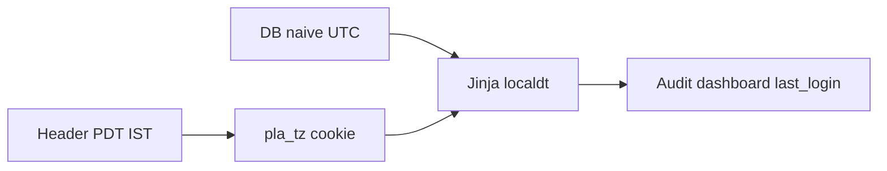

# Session timezone: PDT default, IST switch

## Approach

Store instants in **UTC**. Convert for display and for “today / this month / date filters” using a **per-browser cookie**, default **PDT**. Switching in the header reloads the page so every timestamp on every screen updates.

IANA zones (PDT is seasonal; IST is not):

- **PDT** → `America/Los_Angeles` (Pacific, PDT or PST depending on date)
- **IST** → `Asia/Kolkata`

No new pip dependency: use Python `zoneinfo`.

## Central module

Add [`webapp/timezone.py`](webapp/timezone.py):

- `TIMEZONES = {"PDT": "America/Los_Angeles", "IST": "Asia/Kolkata"}`
- `DEFAULT_TZ = "PDT"`
- `get_tz_key(request)` reads cookie `pla_tz`, falls back to PDT
- `now(request)`, `today(request)` in the selected zone
- `to_utc(dt, tz_key)` for form inputs (`datetime-local`, audit date range)
- `from_utc(dt, tz_key)` treating naive DB values as UTC
- `format_dt(dt, tz_key)` e.g. `2026-10-30 09:15 AM PDT`

A small `POST /settings/timezone` (no `settings.manage` required) sets the cookie and redirects to `Referer` (or `/`).

## Header control (every logged-in page)

In [`webapp/templates/base.html`](webapp/templates/base.html), next to the theme toggle, a compact PDT / IST `<select>` that submits the POST. Show the current abbreviation (PDT vs PST is automatic from `America/Los_Angeles`).

## Display: one Jinja filter everywhere

Register `localdt` in [`webapp/templating.py`](webapp/templating.py) from the request cookie. Replace raw timestamps:

- [`webapp/templates/audit/list.html`](webapp/templates/audit/list.html)
- [`webapp/templates/dashboard/index.html`](webapp/templates/dashboard/index.html)
- [`webapp/templates/users/list.html`](webapp/templates/users/list.html)
- [`webapp/templates/converters/tool.html`](webapp/templates/converters/tool.html)
- [`webapp/templates/tally/_recent.html`](webapp/templates/tally/_recent.html)
- [`webapp/templates/settings/tokens.html`](webapp/templates/settings/tokens.html)

CSV export in [`webapp/routers/audit.py`](webapp/routers/audit.py) uses the same formatter (include the zone abbreviation).

## Clocks and comparisons use the selected zone

Replace mixed `datetime.utcnow()` / `datetime.now()` / `date.today()`:

- [`webapp/routers/auth.py`](webapp/routers/auth.py) `last_login` → UTC now
- [`webapp/routers/converters.py`](webapp/routers/converters.py) `finished_at` → UTC; `work_date` and output stamps → selected zone
- [`webapp/routers/dashboard.py`](webapp/routers/dashboard.py) month KPIs / charts: `today` and month bounds in selected zone, converted to UTC for `created_at` filters
- [`webapp/routers/audit.py`](webapp/routers/audit.py) `date_from` / `date_to` interpreted in selected zone
- [`webapp/routers/users.py`](webapp/routers/users.py) override `starts_at` / `expires_at` parsed as selected zone, stored UTC; compare with UTC now
- [`webapp/policy.py`](webapp/policy.py) expiry checks use UTC (`datetime.now(timezone.utc)`) so they stay correct regardless of display zone
- [`webapp/routers/tally.py`](webapp/routers/tally.py) filename stamps use selected zone

Do **not** rewrite business dates that come from uploaded files (`work_date` already on a record, Tally report `date_from`/`date_to`).

## Existing rows

Keep naive `DateTime` columns. Treat current SQLite `CURRENT_TIMESTAMP` / `datetime.utcnow()` values as **UTC**. No Alembic migration.

## Out of scope

Per-user DB column, company-wide setting, extra zones beyond PDT and IST.
